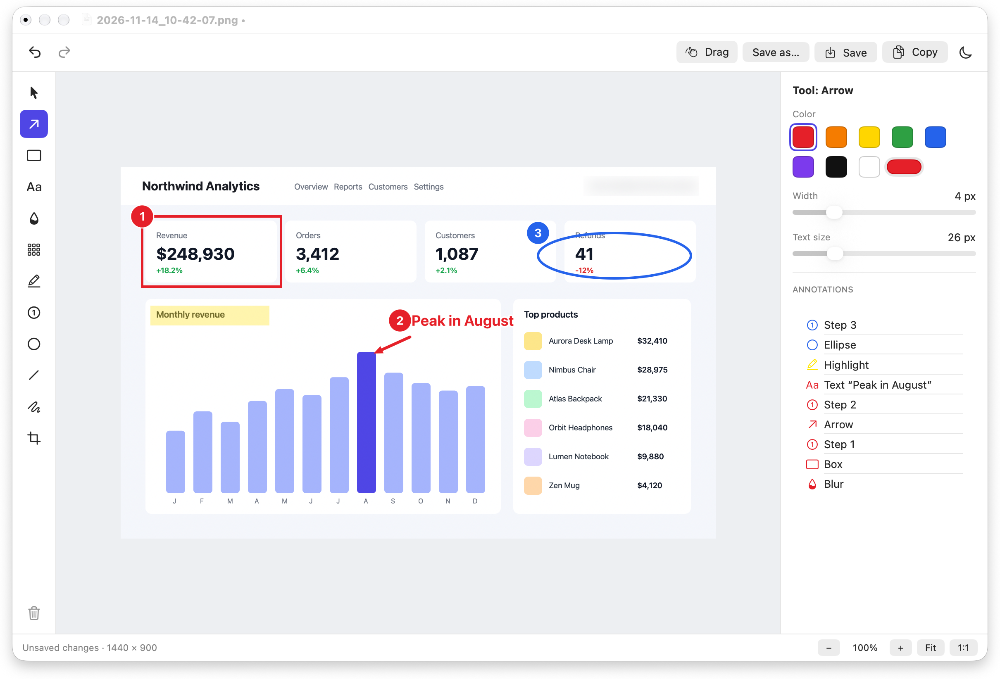
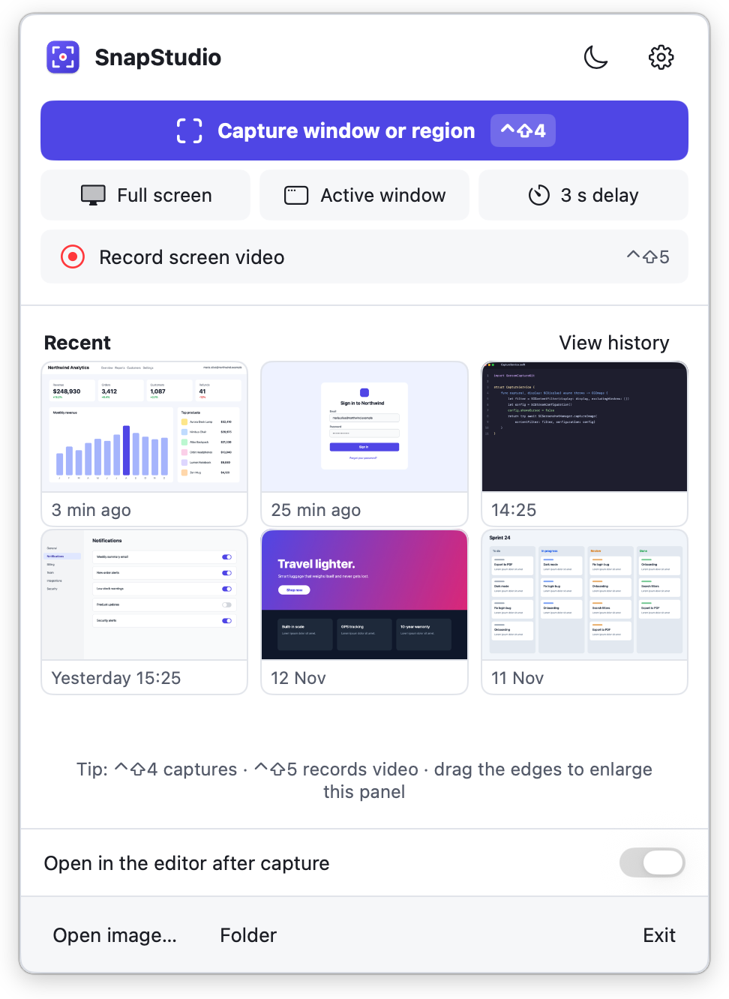
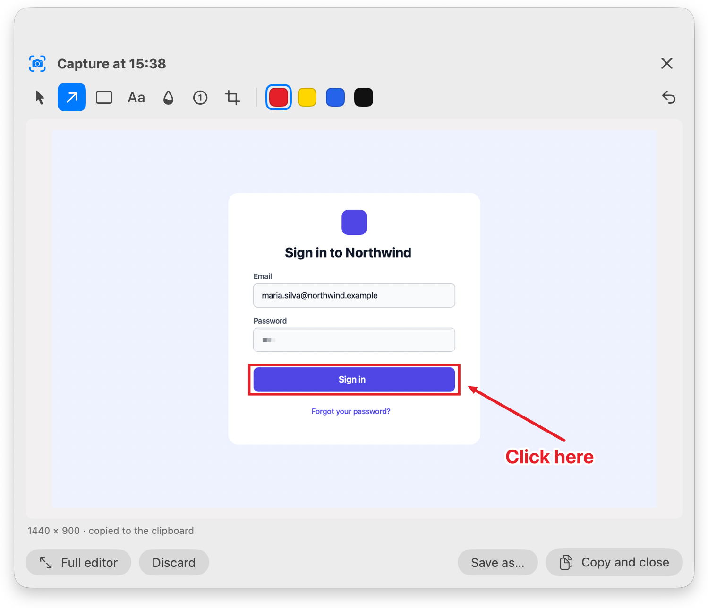
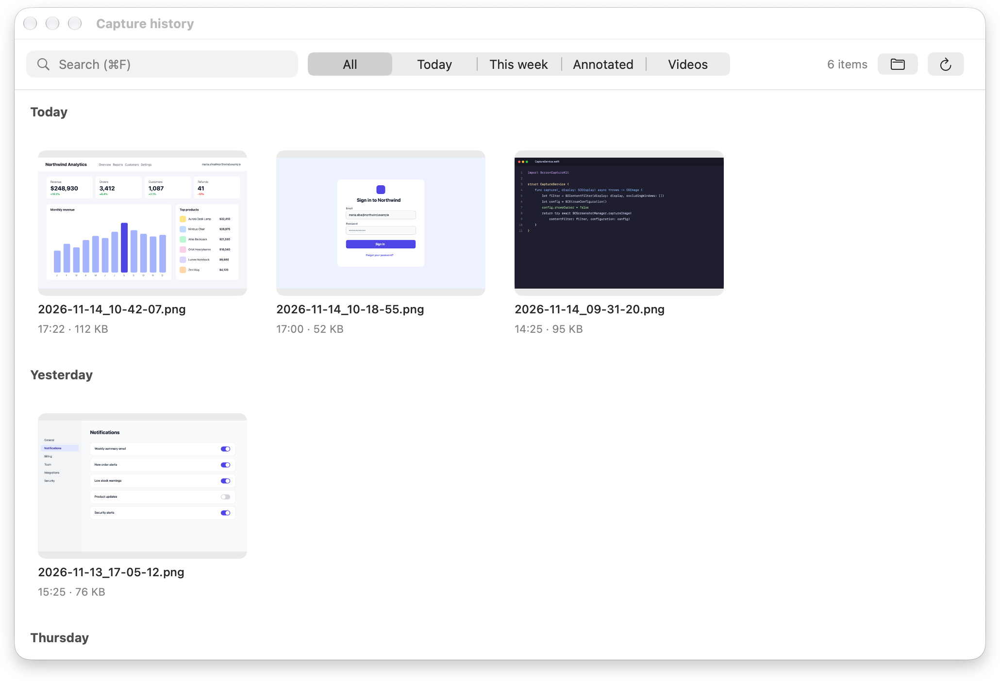

<p align="center">
  
</p>

<h1 align="center">SnapStudio</h1>

<p align="center">
  Screen capture, annotation and screen recording for <b>Windows</b> and <b>macOS</b>.<br>
  Lightweight, no installer, lives in the system tray / menu bar.
</p>

<p align="center">
  <a href="https://github.com/hugolopesdecarvalho/SnapStudio/releases/latest"><b>Download the latest release</b></a>
</p>

<p align="center">
  <picture>
    <source media="(prefers-color-scheme: dark)" srcset="assets/screenshots/editor-dark.png">
    
  </picture>
</p>

---

## Screenshots
<table>
  <tr>
    <td width="38%" valign="top">
      <picture>
        <source media="(prefers-color-scheme: dark)" srcset="assets/screenshots/panel-dark.png">
        
      </picture>
      <p align="center"><b>Panel</b><br>One click from the tray / menu bar.</p>
    </td>
    <td width="62%" valign="top">
      <picture>
        <source media="(prefers-color-scheme: dark)" srcset="assets/screenshots/quick-editor-dark.png">
        
      </picture>
      <p align="center"><b>Quick editor</b><br>Annotate, copy and close in seconds.</p>
      <picture>
        <source media="(prefers-color-scheme: dark)" srcset="assets/screenshots/history-dark.png">
        
      </picture>
      <p align="center"><b>History</b><br>Search, filter and drag captures into other apps.</p>
    </td>
  </tr>
</table>

<sub>Screenshots of the macOS version. The Windows version has the same layout. All content shown is fictional.</sub>

## Features
- **Capture mode**: freeze the screen, then click a window, drag a region, or capture the full screen or all screens. Active-window and 3-second delayed captures are also available.
- **Clipboard first**: every capture is saved and copied to the clipboard, ready to paste anywhere.
- **Quick editor** pop-up and a **full editor**: arrows, boxes, text, blur and pixelate to hide sensitive data, highlighter, numbered steps, ellipses, lines, freehand and crop. Annotations stay editable when you reopen a capture.
- **Screen recording** to MP4 (H.264) at 15/30/60 fps, with pause, stop and cancel. The recording frame and toolbar never appear in the video. Audio is not recorded yet.
- **History** of captures and videos with thumbnails, search, filters and drag-and-drop to other apps.
- **Light and dark themes**, accent colors, configurable shortcuts, PNG or JPG.
- Interface in **English and Portuguese**, following the system language.
- **Update notifications**: SnapStudio checks this repository's releases once a day and tells you when a new version is out (Settings › About shows your version; the check can be turned off). Only a request to GitHub's public API is made, no personal data is sent.

## Download and install
Get the files from the [latest release](https://github.com/hugolopesdecarvalho/SnapStudio/releases/latest).

### Windows 10/11
1. Download **SnapStudio.exe** and put it in any folder. No installation needed: it uses .NET Framework 4.8, which ships with Windows.
2. Open it. The icon appears next to the clock (system tray).
3. The file is not digitally signed, so Windows may show "Windows protected your PC". Click **More info › Run anyway**.

### macOS 14 (Sonoma) or later, Apple Silicon and Intel
1. Download **SnapStudio-macOS.zip**, open it and drag **SnapStudio.app** to **Applications**.
2. The app is not notarized by Apple, so macOS blocks it the first time. Go to *System Settings › Privacy & Security* and click **Open Anyway**.
3. On the first capture, allow SnapStudio in *Privacy & Security › Screen & System Audio Recording*, then reopen the app.

More details in [`mac/README.md`](mac/README.md).

## Using SnapStudio
Click the tray / menu bar icon to open the **panel**: capture, record, see recent captures, switch theme and open the history. Right-click the icon for the full menu.

### Shortcuts
Macs have no PrtScn key, so the macOS version uses ⌃⇧ shortcuts that don't clash with the system's ⌘⇧3/4/5. All shortcuts can be changed in Settings.

| Action | Windows | macOS |
|---|---|---|
| Capture mode (window / region) | **PrtScn** | **⌃⇧4** |
| Active window | Alt+PrtScn | ⌃⇧6 |
| All screens | Ctrl+PrtScn | ⌃⇧3 |
| Record video (start / stop) | Shift+PrtScn | ⌃⇧5 |

In capture mode: click a window, drag a region, **Enter** = full screen, **A** = all screens, **Esc** = cancel.

> **Windows:** if another screen capture app or the Windows Snipping Tool is using PrtScn, SnapStudio warns you. Close that app, or turn off *Windows Settings › Accessibility › Keyboard › "Use the Print screen key to open screen capture"*.

### After a capture
The image is saved to `Pictures/SnapStudio` and copied to the clipboard. Depending on *Settings › After capture*, it then opens in:
- **Quick editor**: a pop-up next to the tray / menu bar with the most-used tools and *Copy and close*. Esc or clicking outside saves and closes. It is only used right after a capture; opening a capture from the panel, the history or a notification always uses the full editor.
- **Full editor**: all tools, properties (color, width, text size) and the annotation list.
- **Nothing**: just save and copy, with a notification.

### Editor
Tool keys (same on both platforms): Select (V), Arrow (A), Box (R), Text (T), **Blur** (B), Pixelate (X), Highlighter (H), Step number (N), Ellipse (E), Line (L), Freehand (P), Crop (C).

| | Windows | macOS |
|---|---|---|
| Save / Save as | Ctrl+S / Ctrl+Shift+S | ⌘S / ⇧⌘S |
| Copy image | Ctrl+C | ⌘C |
| Undo / Redo | Ctrl+Z / Ctrl+Y | ⌘Z / ⇧⌘Z |
| Delete annotation | Delete | ⌫ |
| Zoom | Ctrl+wheel | pinch or ⌘+wheel |

Hold Shift while drawing for 45° angles and squares. Use the **Drag** button to drop the image straight into another app.

Use **‹ ›** in the full editor's header, or Ctrl+← / Ctrl+→ on Windows and ⌘← / ⌘→ on macOS, to move to the previous or next capture in the same folder, oldest to newest. Changes are saved before switching.

After you place an annotation, the editor switches back to **Select** with it selected, so you can move or adjust it right away (numbered steps and freehand stay active to place several in a row). The full editor's properties panel only shows what applies to the selected annotation (or to the active tool):
- **Rounded corners** with an adjustable radius for boxes, the highlighter, blur and pixelate, and a rounded tip for arrows.
- **Fill** with an adjustable opacity for boxes and ellipses.
- **Outline** for text: automatic, white, black or none.

Every choice is remembered like color and width.

### Screen recording
Start a recording with the shortcut or the *Record screen video* button, then choose a window, a region or the full screen. Recording starts after a 3-second countdown. A red frame marks the area and a floating bar shows the time, with **Pause**, **Stop** and **Cancel**. Press the shortcut again to stop. The MP4 is saved next to your captures and copied to the clipboard as a file.

## Where files go
| | Windows | macOS |
|---|---|---|
| Captures and videos | `Pictures\SnapStudio` | `~/Pictures/SnapStudio` |
| Settings and editable annotations | `%APPDATA%\SnapStudio` | `~/Library/Application Support/SnapStudio` |

## Building from source
**Windows**: no .NET SDK needed. The script uses the `csc.exe` from the .NET Framework that ships with Windows and writes `bin\SnapStudio.exe`.
```
powershell -ExecutionPolicy Bypass -File build.ps1
```

**macOS**: only the Command Line Tools are needed (`xcode-select --install`). The script builds a universal `mac/build/SnapStudio.app`. `--install` copies it to Applications and `--run` opens it.
```bash
cd mac && ./build.sh --install --run
```

### Releasing a new version
1. Bump the version in **both** places: `src/AssemblyInfo.cs` (Windows) and `VERSION` in `mac/build.sh` (macOS).
2. Build `bin\SnapStudio.exe` on Windows and `SnapStudio-macOS.zip` on a Mac (`cd mac && ./build.sh`, then zip `build/SnapStudio.app` with `ditto -c -k --keepParent`).
3. Create a GitHub release tagged `vX.Y.Z` with both files attached. The apps compare that tag with their own version to offer the update, and pick the `.exe` / `macOS` asset for the download button.

## Repository layout
| Path | Contents |
|---|---|
| `src/` | Windows version (C#, WinForms) |
| `build.ps1`, `app.manifest` | Windows build script and manifest |
| `mac/` | macOS version (Swift, AppKit, SwiftUI), with its own [README](mac/README.md) |
| `assets/` | icon, logo, social preview image and screenshots |
